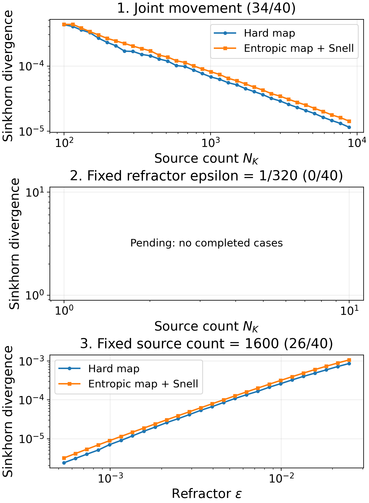
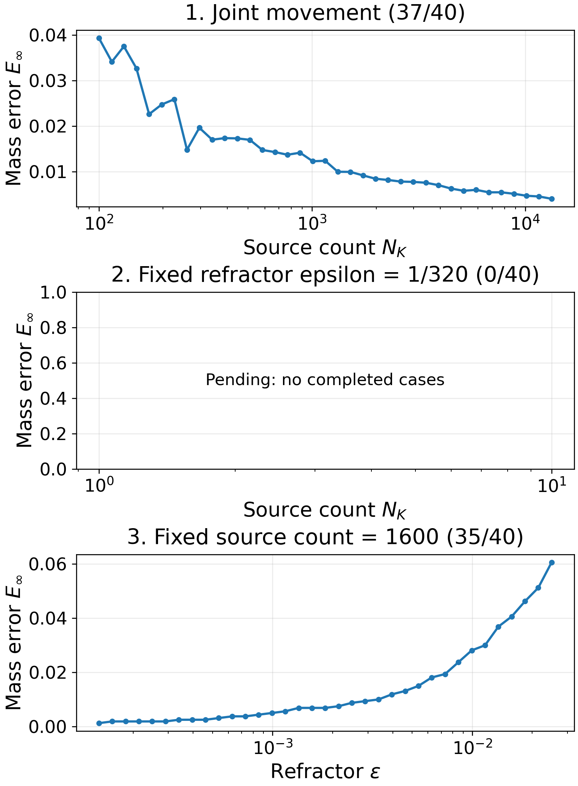
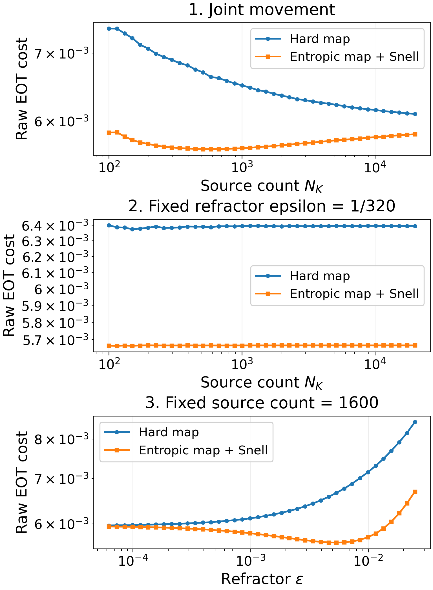
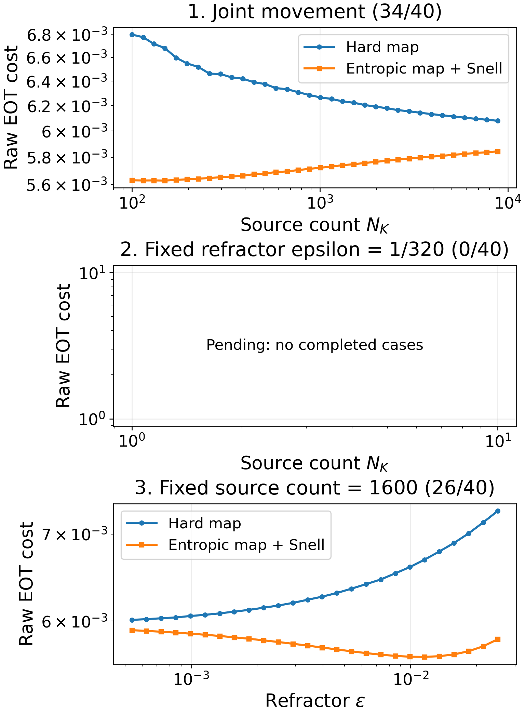

# Geometric optics research write-up

Open `main.tex` as the project main document. The current additions are in
`new_developments.tex`; all image dependencies are in `images/` so the
project can be compiled after cloning without local absolute paths.

Section 8.1 contains the entropic refraction-surface normal derivation, vector
Snell formula, and total-internal-reflection check. Sections 8.2 onward use a
validated completed-case capture. [metadata/results_capture.json](metadata/results_capture.json) records its timestamp,
snapshot directory, case counts, and CSV hashes. Incomplete cases are identified.

Run `python scripts/update_writeup_results.py` from the repository root to
validate and capture the latest debiased tables, refresh the section's numerical
claims, and regenerate its two figures together. It does nothing when the
completed tables have not changed. Mass errors come from the fixed
[hard-map mass-error capture](../results/published/hard_map_mass_error_oct_26_26/README.md). The lower-level plotting command
is `python scripts/plot_writeup_results.py --comparison SNAPSHOT_DIRECTORY`.
Each figure uses three vertically
stacked panels with larger labels. The occupancy-count row has been removed
from the second figure. Its underlying data remain in the
[hard-map occupancy capture](../results/published/hard_map_occupancy_oct_26_26/README.md). The text distinguishes raw
EOT, debiased Sinkhorn divergence, target-mass error, and occupancy counts.
These are fixed captures; see `../results/README.md` for current run status.

Overleaf now includes `new_developments.tex` from its existing `main.tex`.
For updates, upload only that included source and the two figures; image files
are in the project root on Overleaf. Earlier sections were preserved.
The pre-update main source is backed up locally outside the repository.
Export bundles and browser verification images belong in [exports/](exports/README.md).

The source and supporting images are canonical. The earlier ZIP download is
not tracked because it predates subsequent editor revisions. Generated PDF,
compiler intermediates, and editor state are not required to build the project.

The repaired kappa=0.8 progress figures are appended through
[`repaired_kappa_results.tex`](repaired_kappa_results.tex). Refresh this separate
capture with `python scripts/update_repaired_kappa_writeup.py`; it validates and
merges completed main and independent epsilon-worker cases, checks saved-map
hashes, and recomputes hard mass errors from the saved ray assignments. The
original kappa=0.6 figures above are retained.

[Completed-case data and provenance](metadata/repaired_kappa_capture/README.md).
Overleaf includes `repaired_kappa_results.tex` at the end of
`new_developments.tex`; its two new PNG files are stored in the Overleaf project
root. Upload these three files on subsequent repaired-run refreshes.

Raw EOT figures without self-term subtraction are included for both runs in
[`raw_eot_results.tex`](raw_eot_results.tex). Regenerate them after refreshing
the captures with `python scripts/plot_writeup_raw_eot.py`. This checks the
source CSV hashes and uses the same captured cases as the debiased figures.
The hard-map mass-error diagnostic has no debiasing step.

[Raw-EOT provenance](metadata/raw_eot_capture.json). Overleaf includes this
additional source and both raw-EOT images in its project root.

<!-- directory-index:start -->

## Directory guide

[Parent directory](../README.md)

| Folder | Contents |
| --- | --- |
| [exports/](exports/README.md) | Supporting files grouped by purpose. Follow the directory links below and the parent README for context. |
| [images/](images/README.md) | Supporting files grouped by purpose. Follow the directory links below and the parent README for context. |
| [metadata/](metadata/README.md) | Run settings, validation reports, and provenance records. Hash manifests specify their relative hash base where needed. |

<!-- directory-index:end -->
