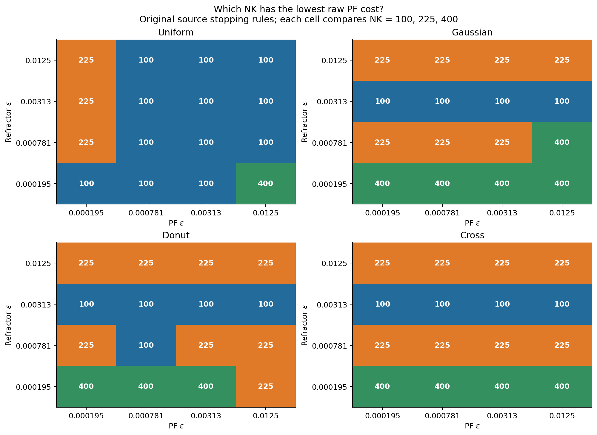

# Exploratory refraction research: illustrated overview

This is a GitHub-readable entry point to the archived laptop research.
For the full narrative, open [`index.html`](index.html) locally after cloning
the repository; its local figure and table links are self-contained.
The [archive README](../README.md) defines the scopes, metrics and limitations.

These are historical small-grid hard-map investigations, not the newer
fixed-1600-target or entropic-surface/Snell production sweeps. A passed
potential-change stopping test does not certify optical marginal feasibility.
Raw PF EOT and debiased divergence are different quantities.

| Study | Saved scope | Detailed notes and data |
| --- | --- | --- |
| Density controls | 48 optical source cases and 192 PF evaluations; all PF tests passed, but inherited optical marginal errors exceeded 1e-6 | [Notes](../density/report.md), [costs](../density/density_costs.csv) |
| Source refinement | 12 paired controls; maximum refined residual about 9.82e-9 | [Comparisons](../density/refinement.csv) |
| Continuation probes | 24 cases; six still exceeded marginal L1 1e-6 after 2000 additional iterations | [Notes](../convergence/REPORT.md), [diagnostics](../convergence/diagnostics.csv) |
| PF bias/reference grid | 72 evaluated rows; 64 passed all three cross/self tests; eight remain excluded from divergence rankings | [Notes](../pf/REPORT.md), [data](../pf/data.csv) |

Native target grids vary with NK; only the PF study's `common` rows use an
independent fixed target with 225 points. Rankings and comparisons are
conditional on these settings, not universal convergence claims. Failed
cold-start diagnostics and partial probes remain archived as diagnostics.

## Density costs and rankings

## Source convergence and refinement

## PF bias and evaluation status

Each figure also has a same-named SVG. Numerical summary counts are retained
in [`summary.json`](summary.json). File hashes and original locations are in
[`../manifest.json`](../manifest.json); desktop checks are in
[`../desktop_import_validation.json`](../desktop_import_validation.json).
