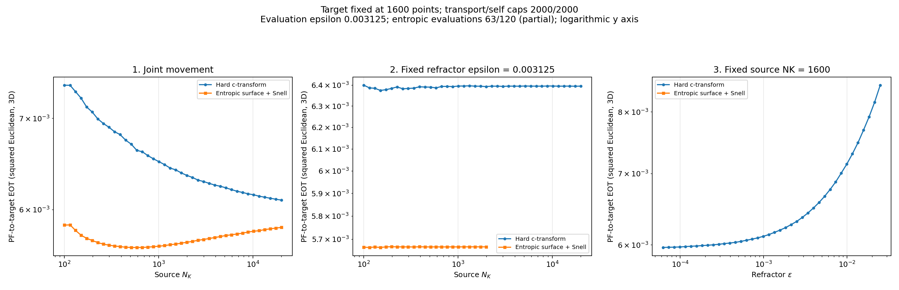

# Entropic-surface sweep snapshot

**PARTIAL: 63/120 evaluations.**

This immutable snapshot contains only CSV-completed cases and their validated solve, PF, and residual checkpoints. The live worker continues in the source directory named in `snapshot.json`. Comparison images were rendered from this snapshot's CSV, not copied from the changing live output. Target fixed at 1600 points; transport/self caps 2000/2000; PF-to-target EOT uses squared Euclidean 3D cost and epsilon 1/320.

The hard comparison is `../../refraction_sweeps_extended_high_iter/`. The snapshot records hashes and validation counts. Incomplete experiments are not final results.

## Logarithmic plots

Both axes use logarithmic scales; nonpositive values are omitted without changing the CSV data.

[Experiment 1](plots/comparison_experiment_1_log.png) | [Experiment 2](plots/comparison_experiment_2_log.png) | [Experiment 3](plots/comparison_experiment_3_log.png)

<!-- directory-index:start -->

## Directory guide

[Parent directory](../README.md)

| Folder | Contents |
| --- | --- |
| [checkpoints/](checkpoints/README.md) | Saved numerical state, separated by solve type. These files allow evaluation or resumption without recomputing completed optical solves. |
| [data/](data/README.md) | Numerical arrays and tabular results for the parent run. NPZ/NPY files retain their original array names; CSV files retain their numerical columns. |
| [diagnostics/](diagnostics/README.md) | Numerical diagnostics, separated from plotted transport costs and optical solution arrays. |
| [metadata/](metadata/README.md) | Run settings, validation reports, and provenance records. Hash manifests specify their relative hash base where needed. |
| [plots/](plots/README.md) | Static figures for the parent run or archived export. See the parent README and parameter metadata for the metric, units, and experiment settings. |

<!-- directory-index:end -->
