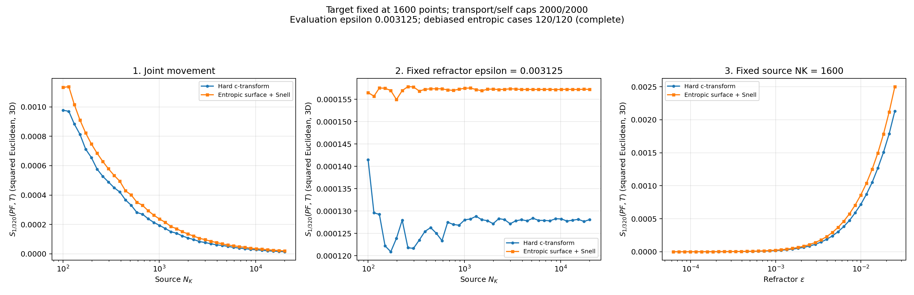
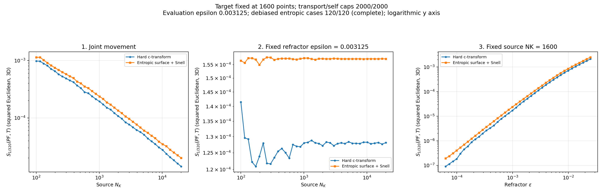

# Debiased hard versus entropic comparison

Hard: **120/120**. Entropic: **120/120**. Complete snapshot; both maps cover every experiment grid.

All three EOT terms converged for every published row. Evaluation uses squared Euclidean distance in 3D, epsilon 1/320, and the KL-relative-to-product convention. The graph shows Sinkhorn divergence itself, without a square root. Optical potential stopping and marginal feasibility are separate; see the optical snapshot residuals.

[Hard data](hard/data/costs.csv) | [Entropic data](entropic/data/costs.csv) | [Validation and counts](metadata/snapshot.json)

<!-- directory-index:start -->

## Directory guide

[Parent directory](../README.md)

| Folder | Contents |
| --- | --- |
| [entropic/](entropic/README.md) | Supporting files grouped by purpose. Follow the directory links below and the parent README for context. |
| [hard/](hard/README.md) | Supporting files grouped by purpose. Follow the directory links below and the parent README for context. |
| [metadata/](metadata/README.md) | Run settings, validation reports, and provenance records. Hash manifests specify their relative hash base where needed. |

<!-- directory-index:end -->
