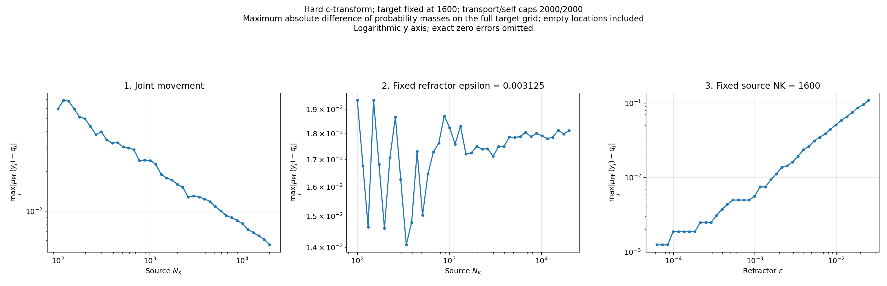

# Maximum absolute hard push-forward mass error

All 120 saved hard-transform cases; no optical solves were repeated.

`max_j |mu_PF(y_j) - q_j|`, where `mu_PF(y_j)` sums source masses mapped to target location `y_j`. Empty target locations have push-forward mass zero and are included. The reference is the saved target measure `q`, which here has mass **1/1600** per target location; source masses are **1/NK**. Values are absolute probability-mass differences, not density errors or a spatial transport distance.

[Per-case CSV](data/max_mass_error.csv) | [Validation and checkpoint hashes](metadata/validation.json)

The CSV also records maximum excess/deficit and the saved zero-based target index where the absolute error is largest (first index if tied).

<!-- directory-index:start -->

## Directory guide

[Parent directory](../README.md)

| Folder | Contents |
| --- | --- |
| [data/](data/README.md) | Numerical arrays and tabular results for the parent run. NPZ/NPY files retain their original array names; CSV files retain their numerical columns. |
| [metadata/](metadata/README.md) | Run settings, validation reports, and provenance records. Hash manifests specify their relative hash base where needed. |
| [plots/](plots/README.md) | Static figures for the parent run or archived export. See the parent README and parameter metadata for the metric, units, and experiment settings. |

<!-- directory-index:end -->
