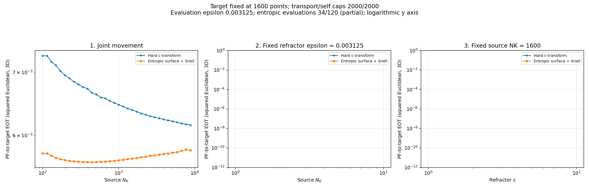
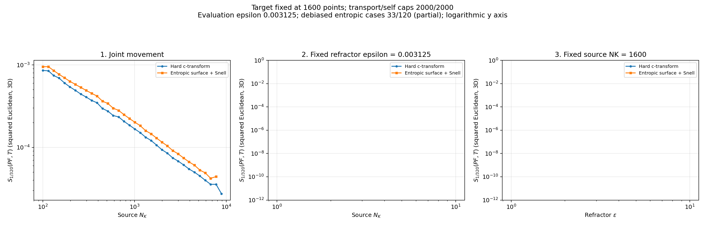
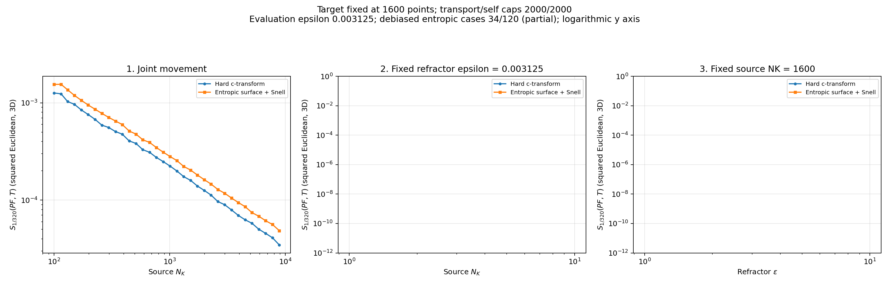
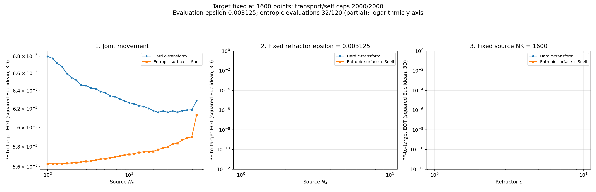
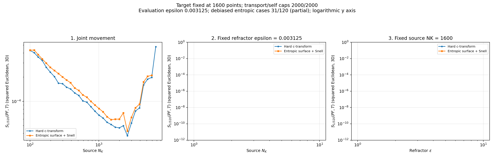

# Three refractor problems — progress plots

Updated **October 28, 2026 at 08:19 AM Eastern Daylight Time**.

Partial results from the extended hard-versus-entropic sweeps. Each problem has 120 cases per map. Empty panels are pending experiments. Optical solves continue in the background.

| Problem | Hard optical | Entropic optical | Hard divergence | Entropic divergence |
| --- | ---: | ---: | ---: | ---: |
| source_only | 34/120 | 34/120 | 34/120 | 33/120 |
| target_only | 36/120 | 35/120 | 34/120 | 34/120 |
| kappa_only | 32/120 | 32/120 | 32/120 | 31/120 |

All published cross-EOT and self-EOT terms passed convergence checks. Divergence values and checkpoint hashes were validated before rendering. Optical marginal feasibility is recorded separately under each optical snapshot’s diagnostics; a converged evaluation does not imply a small optical marginal residual.

## Source Only

[Cross-EOT plots](source_only/entropic/plots/) | [Debiased divergence plots](source_only/debiased/entropic/plots/)

Cross-EOT comparison (log scale):

Debiased Sinkhorn divergence (log scale):

## Target Only

[Cross-EOT plots](target_only/entropic/plots/) | [Debiased divergence plots](target_only/debiased/entropic/plots/)

Cross-EOT comparison (log scale):

Debiased Sinkhorn divergence (log scale):

## Kappa Only

[Cross-EOT plots](kappa_only/entropic/plots/) | [Debiased divergence plots](kappa_only/debiased/entropic/plots/)

Cross-EOT comparison (log scale):

Debiased Sinkhorn divergence (log scale):

