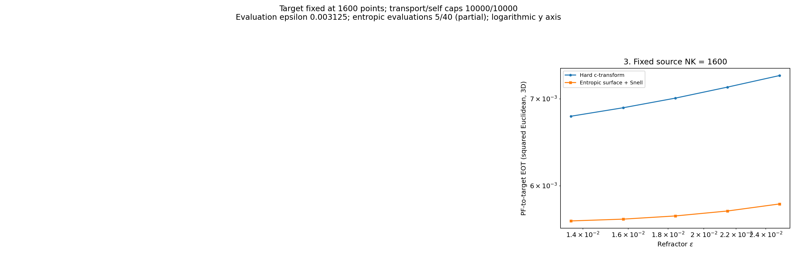
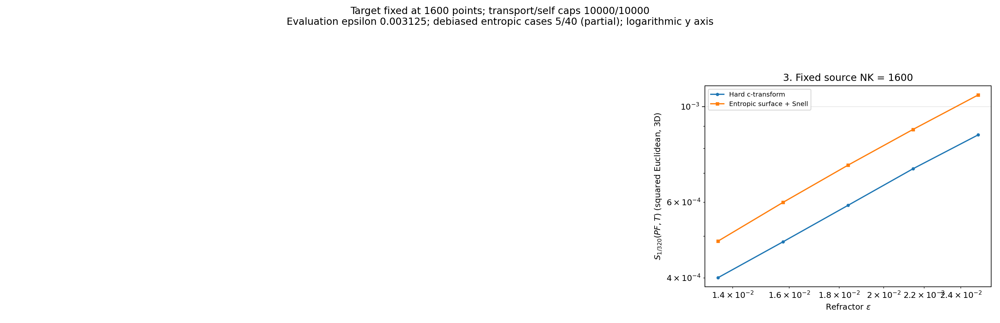

# Additional parallel kappa=0.8 epsilon sweep

Captured October 29, 2026 at 06:57 AM Eastern Daylight Time.

Hard: **5/40**. Entropic: **5/40**. Debiased hard/entropic: **5/5**. These are experiment 3 cases from the original numerical grid, now computed early in parallel with the large-N sweep. The first two panels are unused here.

The algorithm, kappa, geometry, epsilon values, iteration caps and tolerances are unchanged. Two optical processes use two reduction threads each; identical optical solutions are shared. Completed optical checkpoints and cross evaluations are prefetched for reuse by the main sweep.

[Acceleration settings and benchmark](../../runs/repaired_refractor_kappa_oct_28_26/#execution-acceleration--october-29) | [Main joint-movement progress](../repaired_kappa_progress_oct_28_26/)

[All cross-EOT plots](entropic/plots/) | [All divergence plots](debiased/entropic/plots/)
