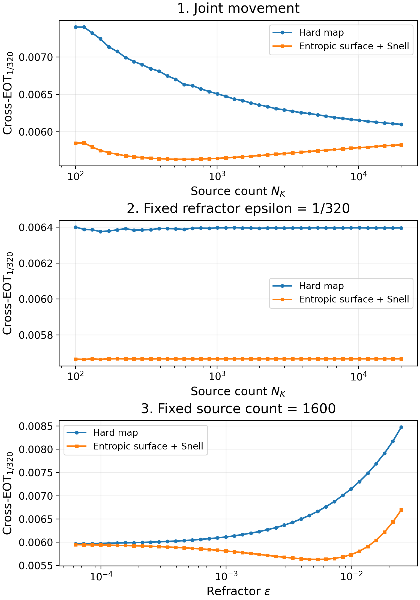
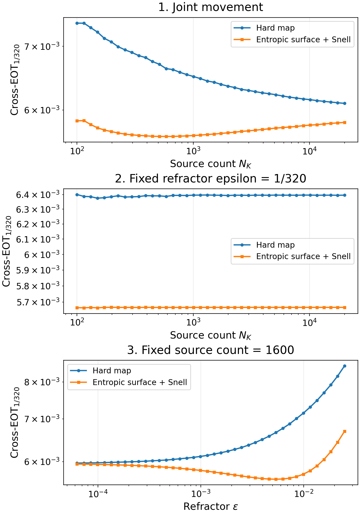

# Entropic error: complete hard versus smooth-map comparison

All **120 cases per map**, with 40 cases in each experiment. These plots use
the saved **cross-EOT objective**, including its entropy penalty, with **no
self-cost subtraction and no square root**. No numerical solves were repeated.

Evaluation epsilon is **1/320**, the ground cost is squared Euclidean distance
between 3D unit directions, and the target has **1600 points**. Both optical
runs use transport/self caps of 2000/2000. Every saved cross evaluation passed
its stopping test. A positive regularized objective can remain even for equal
measures; this quantity differs from debiased Sinkhorn divergence.

## Linear-y comparison



## Log-log comparison



## Individual plots

| Experiment | Linear y | Log-log |
| --- | --- | --- |
| 1: source count and refractor epsilon vary together | [Plot](../../../archive/root_plot_exports_oct_27_26/plots/experiment_1.png) | [Plot](plots/experiment_1_log.png) |
| 2: source count varies, refractor epsilon = 1/320 | [Plot](../../../archive/root_plot_exports_oct_27_26/plots/experiment_2.png) | [Plot](plots/experiment_2_log.png) |
| 3: refractor epsilon varies, source count = 1600 | [Plot](../../../archive/root_plot_exports_oct_27_26/plots/experiment_3.png) | [Plot](plots/experiment_3_log.png) |

Both variants use a logarithmic horizontal axis. The logarithmic variant also
uses a logarithmic vertical axis; the numerical values are unchanged.

[All 240 plotted values](data/costs.csv) | [Metric settings and source hashes](metadata/validation.json)

To regenerate these eight plots from the bundled CSV after cloning:

```bash
python scripts/plot_saved_entropic_error.py
```

The script also accepts `--hard` and `--entropic` source CSVs. For a saved
debiased table it selects only the original `eot` column, never `divergence`;
for an original cross-EOT table it selects `cost`.

<!-- directory-index:start -->

## Directory guide

[Parent directory](../README.md)

| Folder | Contents |
| --- | --- |
| [data/](data/README.md) | Numerical arrays and tabular results for the parent run. NPZ/NPY files retain their original array names; CSV files retain their numerical columns. |
| [metadata/](metadata/README.md) | Run settings, validation reports, and provenance records. Hash manifests specify their relative hash base where needed. |
| [plots/](plots/README.md) | Static figures for the parent run or archived export. See the parent README and parameter metadata for the metric, units, and experiment settings. |

<!-- directory-index:end -->
