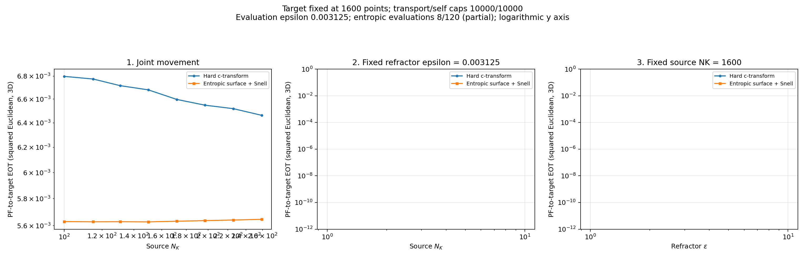
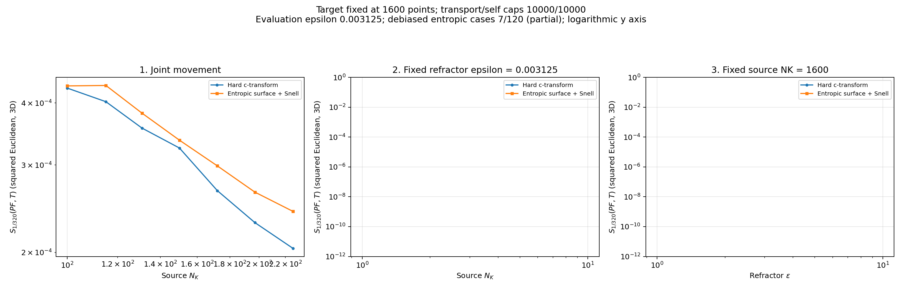

# Repaired kappa=0.8 progress

**Latest capture: [05:08 PM ET](../repaired_kappa_progress_oct_28_26_1708/).**

Captured October 28, 2026 at 08:59 AM Eastern Daylight Time. Original source and target runs are paused. Only the repaired kappa run is active.

Hard optical: **8/120**. Entropic optical: **8/120**. Debiased hard/entropic: **7/7**. Missing panels and points are pending work.

The optical cutoff is removed. Optical transport, source self solve, target self solve, and pushforward evaluation must satisfy marginal feasibility. Old invalid checkpoints are not reused. This is an early partial snapshot; it does not yet reproduce the full repaired joint-movement curve at large N.

[Audit and rerun settings](../../runs/repaired_refractor_kappa_oct_28_26/) | [Cutoff diagnosis](../../runs/kappa_cutoff_diagnostic_oct_28_26/)

## Cross-EOT

## Debiased divergence

[All linear/log cross-EOT plots](entropic/plots/) | [All linear/log divergence plots](debiased/entropic/plots/)
