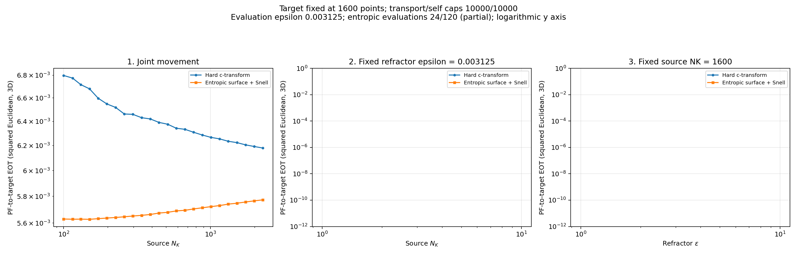
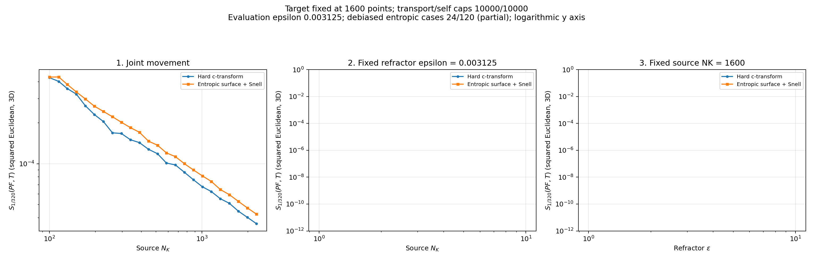

# Repaired kappa=0.8 progress

Captured October 28, 2026 at 10:28 AM Eastern Daylight Time.

Hard optical: **24/120**. Entropic optical: **24/120**. Debiased hard/entropic: **24/24**. Only the repaired kappa sweep is active; original source and target sweeps remain paused. Empty panels are pending experiments.

Every accepted optical transport and self solve passed marginal L1 <=1e-7. This capture reaches source N=2275, beyond the sizes where the old solver began losing mass. The old N=6746 spike point has not yet been reached by the full rerun.

[Audit and settings](../../runs/repaired_refractor_kappa_oct_28_26/) | [Original cutoff diagnosis](../../runs/kappa_cutoff_diagnostic_oct_28_26/)

## Cross-EOT

## Debiased divergence

[All cross-EOT plots](entropic/plots/) | [All divergence plots](debiased/entropic/plots/)
