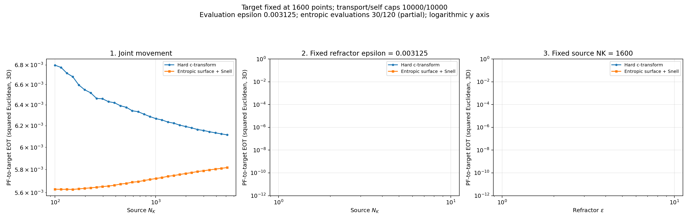

# Repaired kappa=0.8 progress

Captured October 28, 2026 at 05:08 PM Eastern Daylight Time.

Hard optical: **30/120**. Entropic optical: **30/120**. Debiased hard/entropic: **30/30**. Only kappa is active; original source and target sweeps are paused. Empty panels are pending experiments.

All captured optical and self-solve marginal L1 errors are below 1e-7. Divergence continues decreasing through N=5141. The full rerun has not yet reached the old N=6746 spike point.

[Audit and settings](../../runs/repaired_refractor_kappa_oct_28_26/) | [Original cutoff diagnosis](../../runs/kappa_cutoff_diagnostic_oct_28_26/)

## Cross-EOT

## Debiased divergence

[All cross-EOT plots](entropic/plots/) | [All divergence plots](debiased/entropic/plots/)
