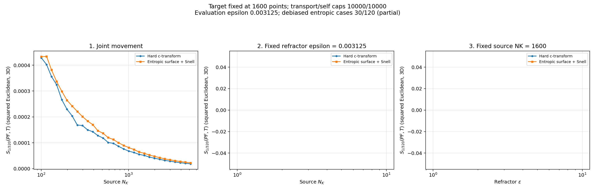
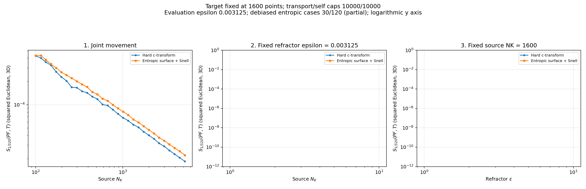

# Debiased hard versus entropic comparison

Hard: **30/120**. Entropic: **30/120**. Partial snapshot; missing entropic cases are still being computed.

All three EOT terms converged for every published row. Evaluation uses squared Euclidean distance in 3D, epsilon 1/320, and the KL-relative-to-product convention. The graph shows Sinkhorn divergence itself, without a square root. Optical potential stopping and marginal feasibility are separate; see the optical snapshot residuals.

[Hard data](hard/data/costs.csv) | [Entropic data](entropic/data/costs.csv) | [Validation and counts](metadata/snapshot.json)
