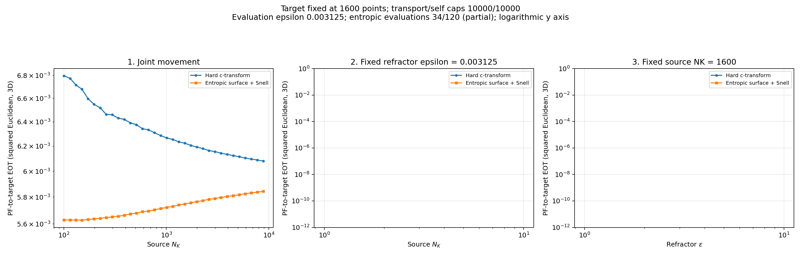
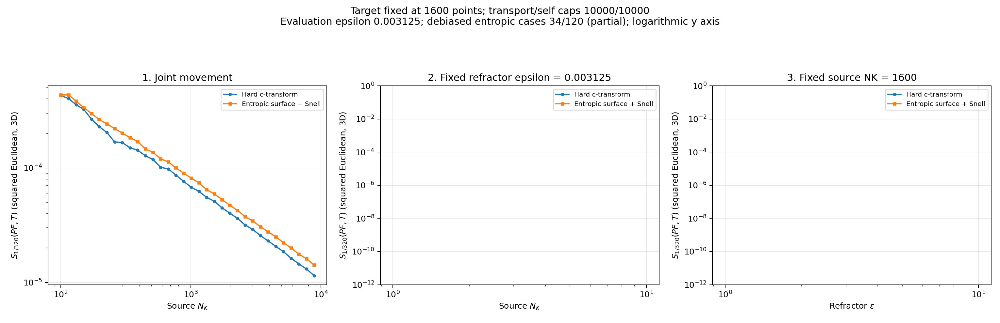

# Repaired kappa=0.8 progress — spike case passed

Captured October 29, 2026 at 06:32 AM Eastern Daylight Time.

Hard optical: **34/120**. Entropic optical: **34/120**. Debiased hard/entropic: **34/34**. Both maps have completed joint movement through N=8852 and are computing N=10140. Source and target sweeps remain paused. Empty panels are pending experiments.

## Full rerun confirms the cutoff repair at N=6746

| Quantity | Original | Repaired full rerun |
| --- | ---: | ---: |
| Hard-map debiased divergence | 0.000478058626 | 0.000014516666 |
| Entropic cross-EOT | 0.006133621956 | 0.005832462694 |
| Entropic debiased divergence | — | 0.000017682830 |

The original hard divergence spike is reduced by 97%. Repaired divergence continues decreasing beyond that point, through N=8852. This agrees with the earlier independent control. Every completed optical transport and source/target self solve has marginal L1 error below 1e-7; there are no logged worker errors.

[Audit and settings](../../runs/repaired_refractor_kappa_oct_28_26/) | [Original cutoff diagnosis](../../runs/kappa_cutoff_diagnostic_oct_28_26/)

## Cross-EOT

## Debiased divergence

[All cross-EOT plots](entropic/plots/) | [All divergence plots](debiased/entropic/plots/)
