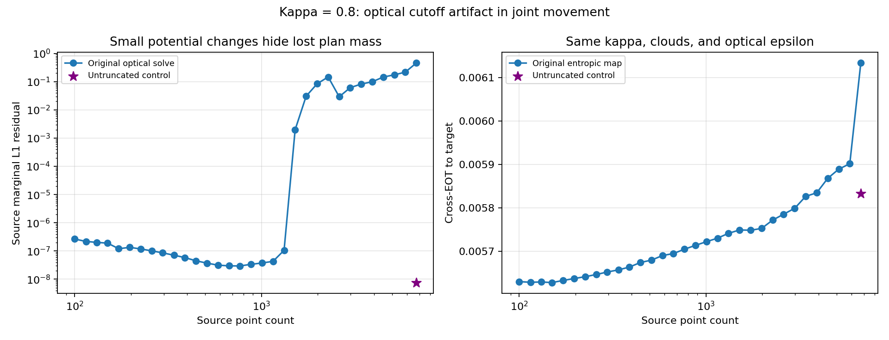

# Kappa joint-movement spike: controlled diagnosis

The spike is caused by an infeasible optical solve produced by the legacy transport cutoff. It is not explained by a change of kappa, the point clouds, evaluation epsilon, or an unconverged pushforward EOT evaluation.

At 6,746 source points, kappa=0.8 and optical epsilon=0.001524390243902439, the original raw optical plan carries only 0.541060894 total mass. The cutoff excludes every retained entry in 3,096 source rows and 737 target columns. These are defects of the optical coupling; pushforward evaluation still normalizes and uses the full input source measure.

| Quantity at 6,746 points | Original | Untruncated control |
| --- | ---: | ---: |
| Optical plan mass | 0.541060894 | 1.000000000 |
| Source marginal L1 residual | 0.458939106 | 7.61e-9 |
| Target marginal L1 residual | 0.462310893 | 3.49e-14 |
| Entropic-map cross-EOT | 0.006133621956 | 0.005832462714 |
| Hard-map cross-EOT | 0.006289576354 | 0.006096087312 |
| Hard-map self-EOT | 0.005662958907 | 0.006203064743 |
| Hard-map debiased divergence | 0.000478058626 | 0.000014516666 |

The hard-map divergence falls by 97%. The original jump from 5,889 to 6,746 points is amplified by debiasing: cross-EOT rises 1.6%, but the source self-EOT falls, so the divergence rises 141%. The untruncated entropic cross-EOT at 6,746 points is below the preceding original value of 0.005901558043.

## Mechanism

In `sinkhorn_step`, the legacy cutoff is `log(1e-6 / len(x))`. Smaller optical epsilon makes the exponential weights sharper. When the cutoff removes an entire supported row or column, its log-sum-exp becomes minus infinity. The `isfinite` guard then substitutes a zero log update. That potential freezes, and the stopping statistic can report a small update even while the full optical plan violates the prescribed marginals.

A two-point reproduction with f=-100 and g=0 produces unchanged potentials and reports change=0 despite no retained transport entries. At 6,746 points the production solve stopped after 389 updates, with final_change=9.87e-6; it did not hit its 2,000-update cap. Increasing the cap alone does not address false convergence.

## Controls and scope

The controls keep the same kappa, source and target point clouds, uniform weights, optical epsilon, Snell construction, and evaluation epsilon=1/320. Only the optical cutoff is removed, with explicit marginal checks on the replacement solve.

At 2,275 points, a log-domain untruncated control restores mass from 0.853181309 to 1 and source L1 from 0.146818694 to 2.24e-8. An independent kernel-scaling implementation agrees in gauge-adjusted target potentials within 1.15e-9; its cross-EOT agrees with the log-domain evaluator within 3.7e-16. The large control uses this validated kernel method, with kernel exponents between -325.1 and 0, safely above underflow. Re-evaluating the original hard map reproduces its stored divergence within 6e-15.

This diagnosis reports corrected entropic cross-EOT and corrected hard-map divergence. It is not a complete repaired parameter sweep. Original production results remain intact. The cutoff problem can affect other geometries as well; optical marginal residuals must gate interpretation independently of evaluation convergence.

The production repair should remove or safely replace the cutoff, prevent nonfinite supported reductions from being treated as successful zero updates, and require marginal feasibility before accepting an optical solve. Affected cases need separate validated reruns so cached invalid solves are not reused.

[Reproduction script](../../../scripts/diagnose_kappa_cutoff.py) | [Large-case optical and entropic control](metadata/cutoff_NK6746.json) | [Hard-map divergence control](metadata/hard_control_NK6746.json) | [Smaller log-domain control](metadata/cutoff_NK2275.json)
