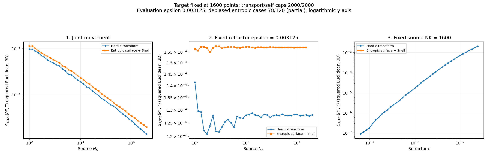
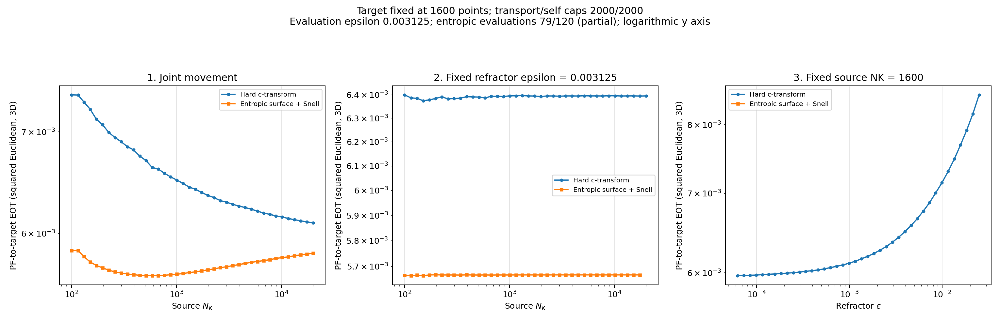

# Updated hard versus entropic comparison images

October 26, 2026, 18:39 ET capture.

Hard: **120/120**. Entropic cross-EOT: **79/120**. Entropic debiased Sinkhorn: **78/120**. Incomplete curves show only completed cases.

## Debiased Sinkhorn divergence

[Linear-y version](debiased/entropic/comparison_experiments_1_2_3.png) | [Data and validation](debiased/)

## Cross-EOT

[Linear-y version](eot/entropic/comparison_experiments_1_2_3.png) | [Hard CSV](eot/hard/costs.csv) | [Entropic CSV](eot/entropic/costs.csv)

Each family also includes separate plots for experiments 1, 2 and 3. Target fixed at 1600; evaluation epsilon 1/320. This gallery captures tables and plots; full optical checkpoint archives remain in earlier optical snapshots and the local live run.
