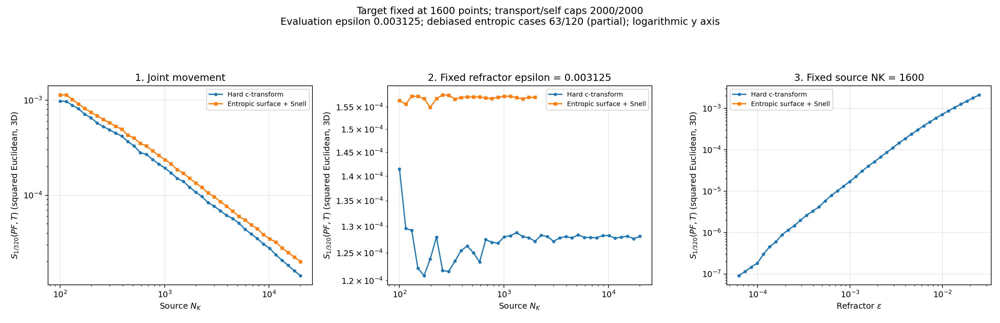

# Debiased hard versus entropic comparison

Hard: **120/120**. Entropic: **63/120**. Partial snapshot; missing entropic cases are still being computed.

All three EOT terms converged for every published row. Evaluation uses squared Euclidean distance in 3D, epsilon 1/320, and the KL-relative-to-product convention. The graph shows Sinkhorn divergence itself, without a square root. Optical potential stopping and marginal feasibility are separate; see the optical snapshot residuals.

[Hard data](hard/costs.csv) | [Entropic data](entropic/costs.csv) | [Validation and counts](snapshot.json)

## Logarithmic plots

Both axes use logarithmic scales; nonpositive values are omitted without changing the CSV data.

[Experiment 1](entropic/comparison_experiment_1_log.png) | [Experiment 2](entropic/comparison_experiment_2_log.png) | [Experiment 3](entropic/comparison_experiment_3_log.png)
