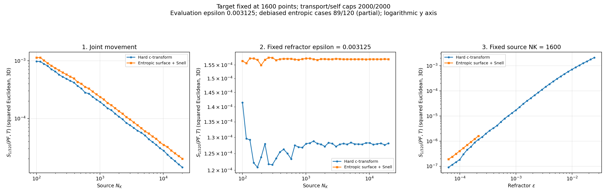

# Debiased evaluation: resources and latest results

Cross-EOT generation and its plot worker are paused at the user's request.
Debiased evaluation has caught up to all **89 saved entropic cases**: 40 in
experiment 1, 40 in experiment 2, and 9 in experiment 3. Hard: **120/120**.
The remaining 31 entropic cases require additional optical/cross-EOT outputs;
the debiased worker waits for those while cross-EOT remains paused.

The running debiased worker uses **4 reduction threads**, **normal CPU priority**,
and a cost cache capped at **4 million entries (32 MB)**. Parallelism divides
independent outputs of SciPy logsumexp; epsilon, objective, tolerance and
completed self-term caches are preserved. It runs independently of Codex under
Windows Task Scheduler.

[Benchmark](benchmark.json): a saved 1600-point self solve took 13.52 seconds
with one thread and 8.19 seconds with four, a **1.65x speedup**. The objective,
69 iterations, convergence and all diagnostics matched exactly. This sample
does not predict every case's runtime. All 22 tests passed.

[Linear-y plot](comparison/entropic/comparison_experiments_1_2_3.png) |
[Data, per-experiment plots and validation](comparison/)

Persistent local pause markers for `sweep` and `plots` prevent those roles from
restarting automatically. Debiasing remains active and is currently caught up.
