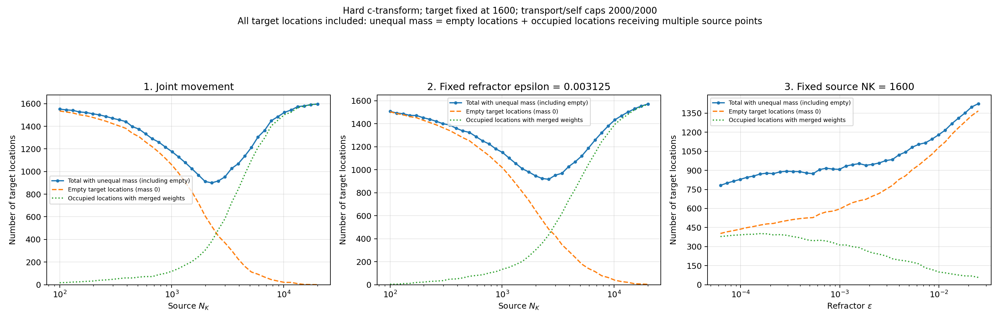
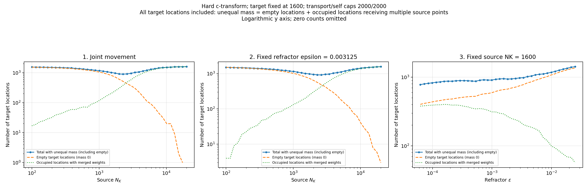

# Hard push-forward atom weights

120 saved cases from the hard-transform 2000/2000-cap sweep; no optical solves were repeated.

At every saved target location, sum the weights of all source points mapped there, assigning zero to empty locations. Count all locations whose mass differs from `1/NK` (source NK). For these uniform-source runs, the total equals empty locations plus locations receiving at least two source points, or equivalently target count minus singleton locations. The plots show the total and its empty/merged components.

[Per-case counts](atom_counts.csv) use `unequal_target_locations` for the total including empty locations; the previous `unequal_weight_atoms` column still counts only occupied locations with merged weights. Other columns include occupied/singleton counts, empty target locations, source points in merged atoms, maximum multiplicity, and unequal fraction of occupied support. [Validation](validation.json) records uniform-source and mass-conservation checks and checkpoint hashes.
