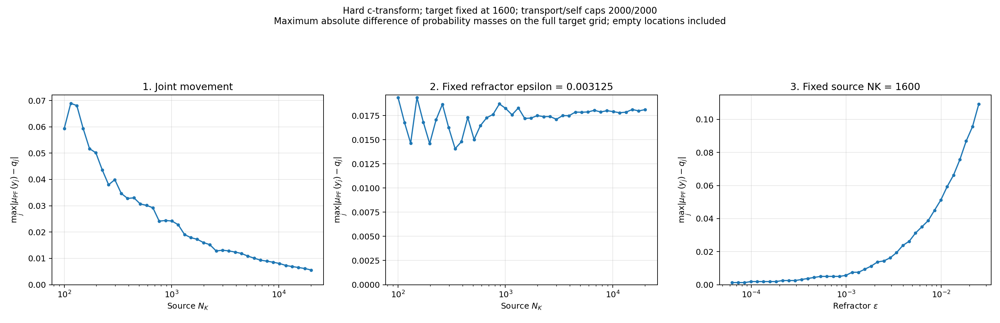

# Maximum absolute hard push-forward mass error

All 120 saved hard-transform cases; no optical solves were repeated.

`max_j |mu_PF(y_j) - q_j|`, where `mu_PF(y_j)` sums source masses mapped to target location `y_j`. Empty target locations have push-forward mass zero and are included. The reference is the saved target measure `q`, which here has mass **1/1600** per target location; source masses are **1/NK**. Values are absolute probability-mass differences, not density errors or a spatial transport distance.

[Per-case CSV](max_mass_error.csv) | [Validation and checkpoint hashes](validation.json)

The CSV also records maximum excess/deficit and the saved zero-based target index where the absolute error is largest (first index if tied).
